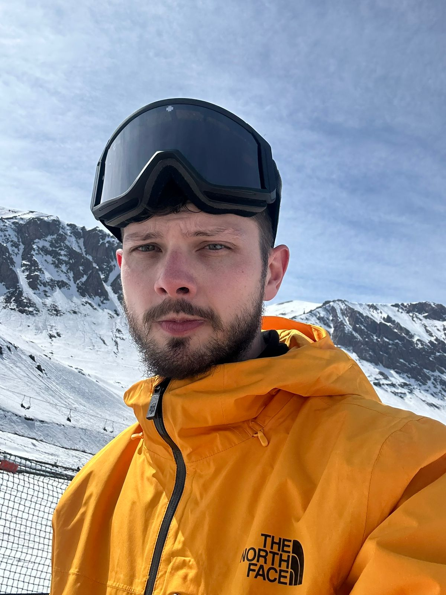
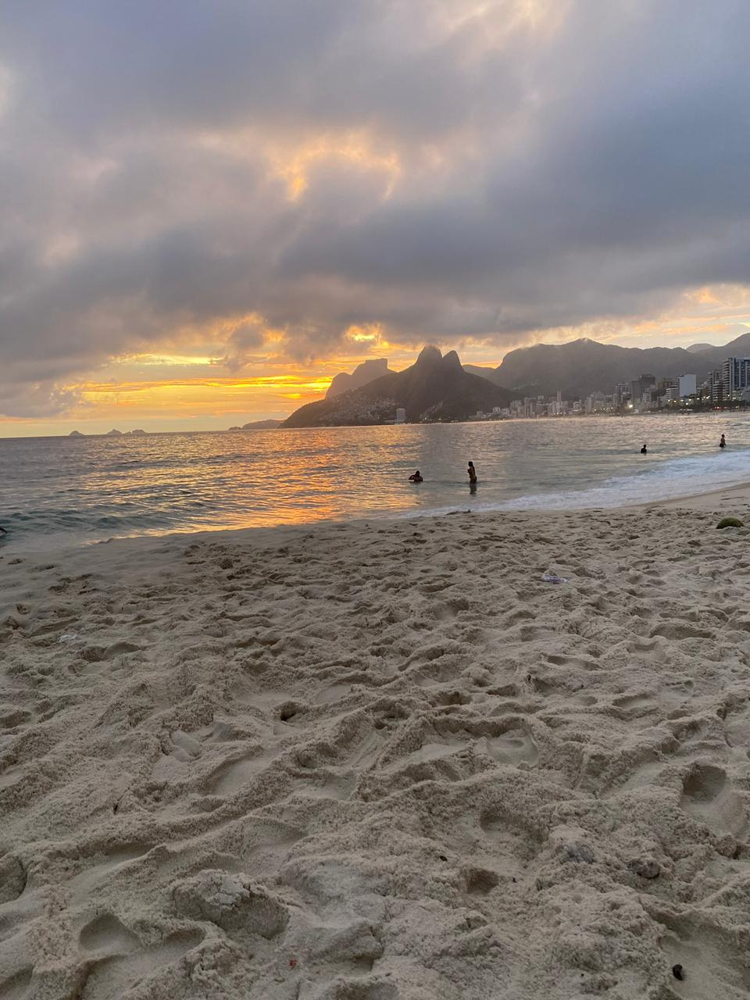
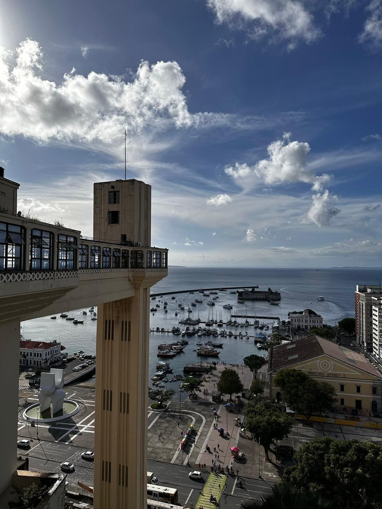
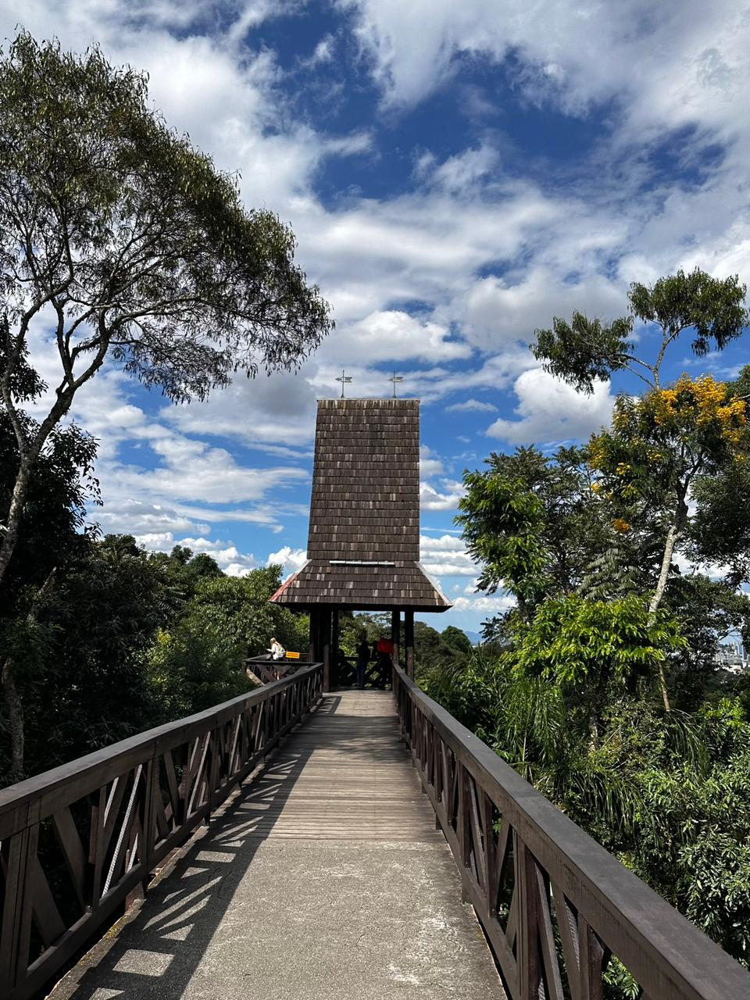

<div align="center">



# João D'Avila

**Senior Android Engineer** · Kotlin · Jetpack Compose · Based in Brazil 🇧🇷

*Crafting scalable, high-quality mobile experiences.*

[📧 Email](mailto:im.joaodavila@gmail.com)

</div>

---

### Hi there 👋

7+ years building global products with a relentless focus on clean code, performance and long-term maintainability.

```kotlin
data class MyProfile(
    val pronouns: String = "he|him",
    val askMeAbout: List<String> = listOf("Kotlin", "Compose", "Swift", "TypeScript"),
    val currentlyLearning: List<String> = listOf(
        "Compose Multiplatform", "React Native", "Data Science", "Swift"
    ),
    val languages: Map<String, String> = mapOf(
        "Portuguese" to "Native", "English" to "Fluent",
        "Spanish" to "Advanced", "Japanese" to "Learning"
    )
)
```

### Beyond the code

- 🛠️ **Modernization** — modularization, Compose adoption, better developer tooling
- 🤝 **Collaboration** — turning abstract ideas into reliable solutions with design, product and QA
- ⚡ **Proactive ownership** — chasing edge cases, improving observability, documenting for speed
- 🤖 **AI-enhanced workflow** — using AI to ship faster without compromising quality

### Location independent, curious by nature

Worked remotely from 🇦🇷 Argentina · 🇨🇱 Chile · 🇨🇴 Colombia · 🇨🇷 Costa Rica
Into travel, fitness and photography.

### The arcade 🎮

Elden Ring · Hearthstone · Expedition 33 · Star Wars Jedi

### Captured moments 📷

<p>
  
  
  
  
</p>

<br>

[**Know more →**](https://joaodavil4.github.io/html-johnpage/)
